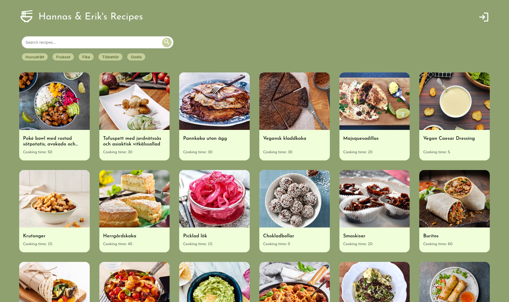
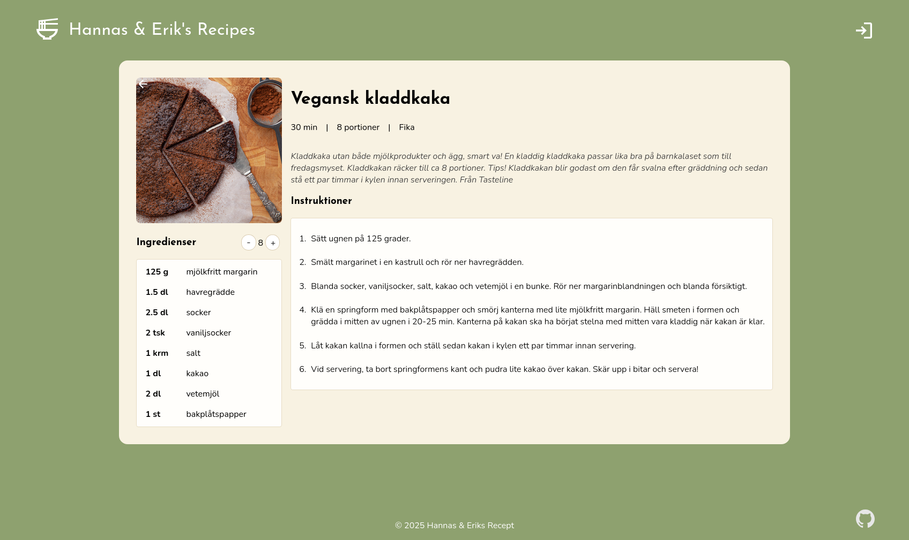
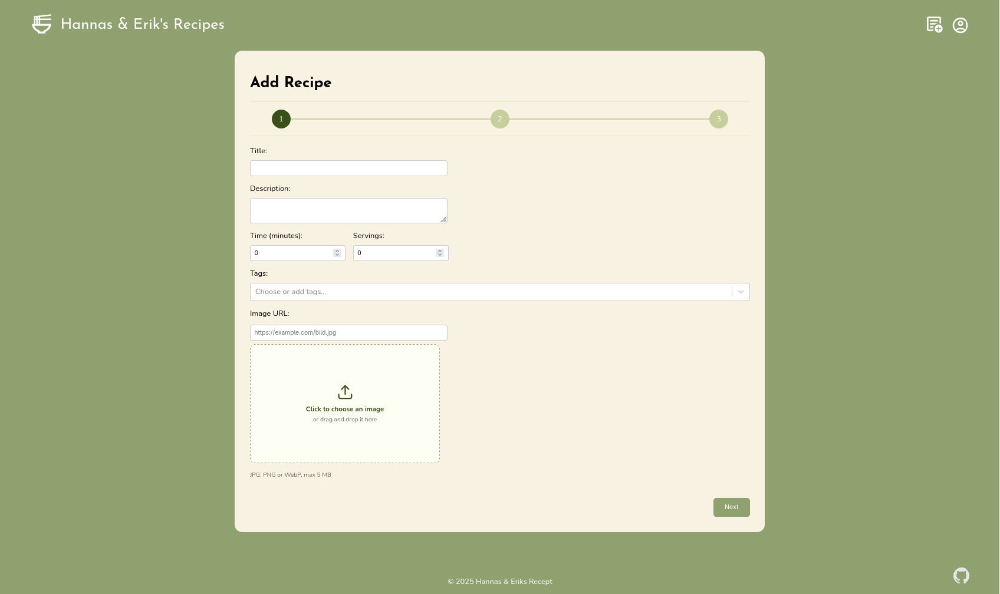
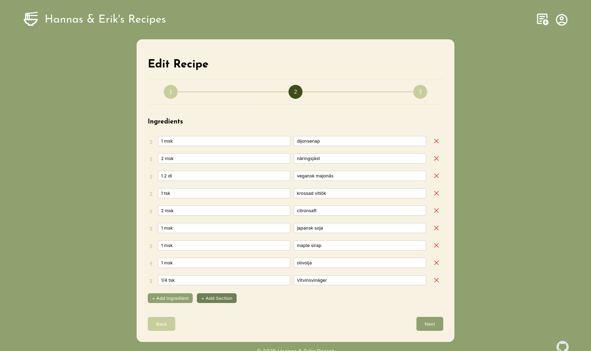

<h1 align="center">Heap Recipes</h1>

<p align="center">
  A full-stack recipe manager for discovering, organizing, and sharing recipes.
</p>

<p align="center">
  <a href="#features">Features</a> ·
  <a href="#screenshots">Screenshots</a> ·
  <a href="#getting-started">Getting started</a> ·
  <a href="#docker">Docker</a> ·
  <a href="#api">API</a> ·
  <a href="#testing">Testing</a>
</p>

<div align="center">

[![Last Commit][last-commit-shield]][last-commit-url]
[![Repo Size][repo-size-shield]][repo-size-url]
[![Build Status][build-shield]][build-url]
[![Test Coverage][coverage-shield]][coverage-url]
[![Author1][author-shield1]][author-url1]
[![Author2][author-shield2]][author-url2]

![React][react-shield]
![TypeScript][typescript-shield]
![Vite][vite-shield]
![.NET][dotnet-shield]
![PostgreSQL][postgresql-shield]
![JWT][jwt-shield]

![Vitest][vitest-shield]
![Testing Library][testinglibrary-shield]
![Docker][docker-shield]
![GitHub Actions][githubactions-shield]
![SonarQube][sonarqube-shield]

</div>

---

Heap Recipes is developed by [Hanna Adenholm](https://github.com/adenholm) and
[Erik Persson](https://github.com/erikpersson0884).

## Features

- 🔍 Browse recipes with text search and tag filters.
- 📖 View descriptions, preparation time, servings, images, ingredients, and instructions.
- 🧩 Organize ingredients and instructions into ordered sections.
- ✏️ Create, edit, and delete recipes and tags.
- 🖼️ Upload recipe images, served by the API and persisted in Docker.
- 🔐 Authenticate with JWT tokens and protect recipe-management actions.
- 🌱 Seed example recipes automatically in the Development environment.
- 📱 Installable frontend through the Vite PWA setup.

## Screenshots

<table>
  <tr>
    <td width="50%" align="center">
      <b>Homepage</b><br>
      <sub>Browse, search by title, and filter by tags</sub><br><br>
      
    </td>
    <td width="50%" align="center">
      <b>Recipe page</b><br>
      <sub>Details, ingredients, instructions, time, and servings</sub><br><br>
      
    </td>
  </tr>
  <tr>
    <td width="50%" align="center">
      <b>Add recipe</b><br>
      <sub>Create a recipe with image, tags, ingredients, and steps</sub><br><br>
      
    </td>
    <td width="50%" align="center">
      <b>Edit recipe</b><br>
      <sub>Update recipes and reorganize their content</sub><br><br>
      
    </td>
  </tr>
</table>

## Technology

<details>
<summary>Full tech stack</summary>

<br>

| Area | Technologies |
| --- | --- |
| Frontend | React 19, TypeScript, Vite, React Router, Axios |
| Backend | ASP.NET Core 9, Entity Framework Core 9, Swagger/OpenAPI |
| Data and auth | PostgreSQL, JWT, BCrypt |
| Testing | Vitest, Testing Library, jsdom |
| Delivery | Docker, Docker Compose, GitHub Actions, SonarQube |

</details>

## Project structure

```text
.
├── client/                 # React/Vite frontend
│   ├── src/pages/          # Main, recipe, add, edit, and tag screens
│   ├── src/components/     # Shared UI components
│   └── src/service/        # API client
├── server/                 # ASP.NET Core API
│   ├── Controllers/        # Auth, recipe, tag, and image endpoints
│   ├── Data/               # EF Core context, models, seed data, migrations
│   └── Services/           # JWT, image storage, and cleanup services
├── docs/images/            # Screenshots used in this README
├── docker-compose.yml      # PostgreSQL, API, and frontend services
└── package.json            # Convenience scripts for local development
```

---

## Getting started

### Prerequisites

- Node.js 22 or newer and npm
- .NET SDK 9
- Docker Desktop or Docker Engine with Compose

### 1. Install frontend dependencies

From the repository root:

```bash
npm run setup
```

This installs the dependencies in `client/`.

### 2. Start PostgreSQL

Create a `.env` file using [.env.example](.env.example).

The default Compose database is intentionally on the internal Docker network. To
expose it to local .NET development, create `docker-compose.override.yml`:

```yaml
services:
  db:
    ports:
      - "5432:5432"
```

Then start the database:

```bash
docker compose up -d db
```

### 3. Configure the API

Create `server/appsettings.Development.json`:

```json
{
  "ConnectionStrings": {
    "DefaultConnection": "Host=localhost;Port=5432;Database=heap_recipes;Username=heap_recipes;Password=change-me"
  },
  "Jwt": {
    "Key": "replace-with-a-random-secret-at-least-32-characters",
    "Issuer": "HeapRecipesApi",
    "Audience": "HeapRecipesApiUsers",
    "ExpireMinutes": "60"
  },
  "AllowedOrigins": "http://localhost:5173"
}
```

> [!WARNING]
> Do not commit passwords or JWT keys. Keep `appsettings.Development.json` out of git.

### 4. Create a default user (optional)

For a local default user, use ASP.NET Core
[user secrets](https://learn.microsoft.com/en-us/aspnet/core/security/app-secrets)
from the `server/` directory:

```bash
cd server
dotnet user-secrets init
dotnet user-secrets set "DefaultUser:Username" "admin"
dotnet user-secrets set "DefaultUser:Password" "choose-a-strong-password"
dotnet user-secrets set "DefaultUser:Role" "Admin"
```

> [!NOTE]
> The default user is created once at startup, when both credentials are present.
> Changing the configured password later does not update an existing user.

### 5. Run the application

Use two terminals:

```bash
# Terminal 1
npm run server

# Terminal 2
npm run client
```

Or start both together:

```bash
npm run dev
```

| Service | URL |
| --- | --- |
| Frontend | <http://localhost:3000> |
| API | <http://localhost:5036> (HTTPS: <https://localhost:7153>) |
| Swagger | `/swagger` while the API runs in Development |

---

## Docker

To run the complete stack, configure `.env` and start all services:

```bash
docker compose up --build
```

The frontend is available at <http://localhost:3000>. Nginx serves the frontend
and proxies `/api/` and `/uploads/` to the backend. PostgreSQL data is stored in
the `postgres_data` volume and uploaded images in `recipe_uploads`.

<details>
<summary>Environment variables expected by the Compose backend</summary>

<br>

| Variable | Purpose |
| --- | --- |
| `ASPNETCORE_ENVIRONMENT` | API environment, normally `Production` |
| `ConnectionStrings__DefaultConnection` | PostgreSQL connection string |
| `JWT__Key` | JWT signing key, at least 32 characters |
| `Jwt__Issuer` / `Jwt__Audience` | JWT validation values |
| `Jwt__ExpireMinutes` | Token lifetime in minutes |
| `AllowedOrigins` | Semicolon-separated allowed origins |
| `POSTGRES_DB` / `POSTGRES_USER` / `POSTGRES_PASSWORD` | PostgreSQL initialization |

</details>

---

## API

The API is rooted at `/api`. Interactive documentation is available at
`/swagger` in Development.

| Method | Endpoint | Purpose |
| --- | --- | --- |
| `GET` | `/api/recipe` | List recipes |
| `GET` | `/api/recipe/{id}` | Get one recipe |
| `POST` / `PUT` / `DELETE` | `/api/recipe[/{id}]` | Manage recipes |
| `GET` | `/api/tag` | List tags |
| `POST` / `PUT` / `DELETE` | `/api/tag[/{id}]` | Manage tags |
| `POST` | `/api/images` | Upload an image |
| `POST` | `/api/auth/login` | Get a JWT |
| `GET` | `/api/auth/me` | Get the current user |
| `POST` | `/api/auth/register` | Register a user (authenticated) |
| `GET` | `/health` | Health check |

---

## Testing

Run the frontend test suite from the repository root:

```bash
npm test
```

Or run frontend commands directly:

```bash
cd client
npm run lint
npm test
npm run test:watch
npm run test:coverage
```

GitHub Actions runs frontend tests on pushes and pull requests, builds both
Docker images, and publishes coverage data from the `main` branch.

## Useful scripts

| Command | Description |
| --- | --- |
| `npm run client` | Start the Vite frontend |
| `npm run server` | Start the ASP.NET Core API |
| `npm run dev` | Start frontend and API together |
| `npm run setup` | Install frontend dependencies |
| `npm test` | Run frontend tests |

## Notes

> [!IMPORTANT]
> JWT keys must be at least 32 characters for HS256, otherwise authentication
> will not work (and would be insecure).

- Keep JWT signing keys and database credentials outside version control.
- Database migrations are applied automatically when the API starts.
- Development startup seeds example recipes only when the database has no recipes.


# Authors


<table align="center">
  <tr>
    <td align="center">
      <a href="https://github.com/Adenholm">
        
      </a>
      <br />
      <strong><a href="https://github.com/Adenholm">Hanna Adenholm</a></strong>
      <br />
      <sub>Co-Creator &amp; Maintainer</sub>
    </td>
    <td align="center">
      <a href="https://github.com/erikpersson0884">
        
      </a>
      <br />
      <strong><a href="https://github.com/erikpersson0884">Erik Persson</a></strong>
      <br />
      <sub>Co-Creator &amp; Maintainer</sub>
    </td>
  </tr>
</table>

<!-- Repo info shields -->
[last-commit-shield]: https://img.shields.io/github/last-commit/Adenholm/heap-recipes/main?style=for-the-badge&cacheSeconds=30
[last-commit-url]: https://github.com/Adenholm/heap-recipes/commits/main

[repo-size-shield]: https://img.shields.io/github/repo-size/Adenholm/heap-recipes?style=for-the-badge&cacheSeconds=60
[repo-size-url]: https://github.com/Adenholm/heap-recipes

[build-shield]: https://img.shields.io/github/actions/workflow/status/Adenholm/heap-recipes/test.yml?branch=main&style=for-the-badge
[build-url]: https://github.com/Adenholm/heap-recipes/actions

<!-- Authors -->
[author-shield1]: https://img.shields.io/badge/Author-Hanna%20Adenholm-purple?style=for-the-badge
[author-url1]: https://github.com/Adenholm

[author-shield2]: https://img.shields.io/badge/Author-Erik%20Persson-purple?style=for-the-badge
[author-url2]: https://github.com/erikpersson0884

<!-- Test coverage shield -->
[coverage-shield]: https://img.shields.io/endpoint?url=https://raw.githubusercontent.com/adenholm/heap-recipes/coverage/.github/coverage.json&style=for-the-badge&v=2
[coverage-url]: https://github.com/adenholm/heap-recipes/actions

<!-- Frameworks & languages shields -->
[react-shield]: https://img.shields.io/badge/React-61DAFB?logo=react&logoColor=black&style=for-the-badge
[typescript-shield]: https://img.shields.io/badge/TypeScript-3178C6?logo=typescript&logoColor=white&style=for-the-badge
[vite-shield]: https://img.shields.io/badge/Vite-646CFF?logo=vite&logoColor=white&style=for-the-badge
[dotnet-shield]: https://img.shields.io/badge/.NET-512BD4?logo=dotnet&logoColor=white&style=for-the-badge
[postgresql-shield]: https://img.shields.io/badge/PostgreSQL-4169E1?logo=postgresql&logoColor=white&style=for-the-badge
[jwt-shield]: https://img.shields.io/badge/JWT-000000?logo=jsonwebtokens&logoColor=white&style=for-the-badge

<!-- Testing & delivery shields -->
[vitest-shield]: https://img.shields.io/badge/Vitest-6E9F18?logo=vitest&logoColor=white&style=for-the-badge
[testinglibrary-shield]: https://img.shields.io/badge/Testing%20Library-E33332?logo=testinglibrary&logoColor=white&style=for-the-badge
[docker-shield]: https://img.shields.io/badge/Docker-2496ED?logo=docker&logoColor=white&style=for-the-badge
[githubactions-shield]: https://img.shields.io/badge/GitHub%20Actions-2088FF?logo=githubactions&logoColor=white&style=for-the-badge
[sonarqube-shield]: https://img.shields.io/badge/SonarQube-4E9BCD?logo=sonarqubeserver&logoColor=white&style=for-the-badge